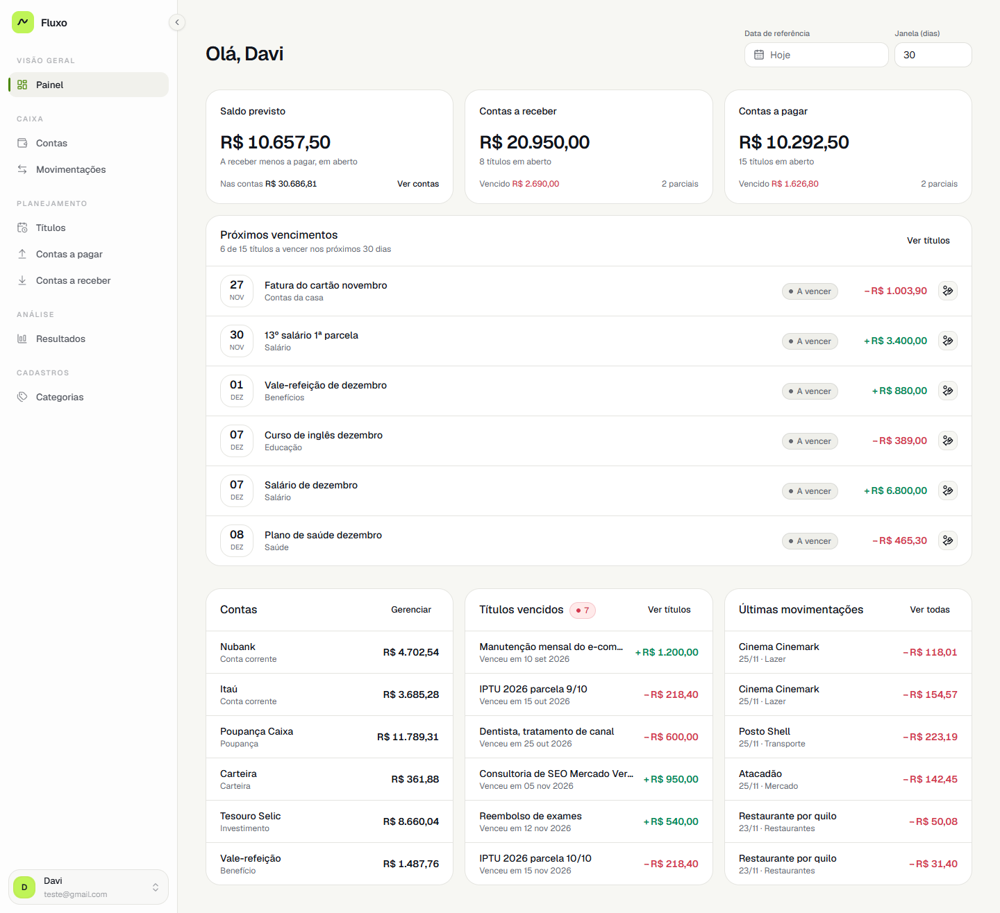
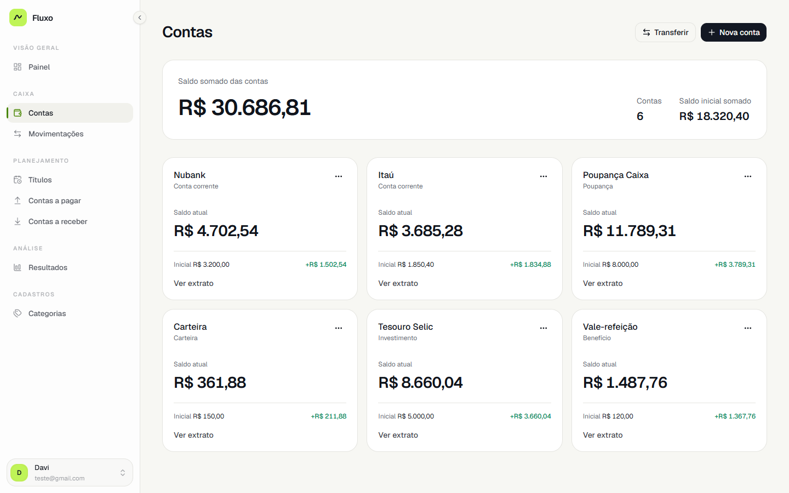
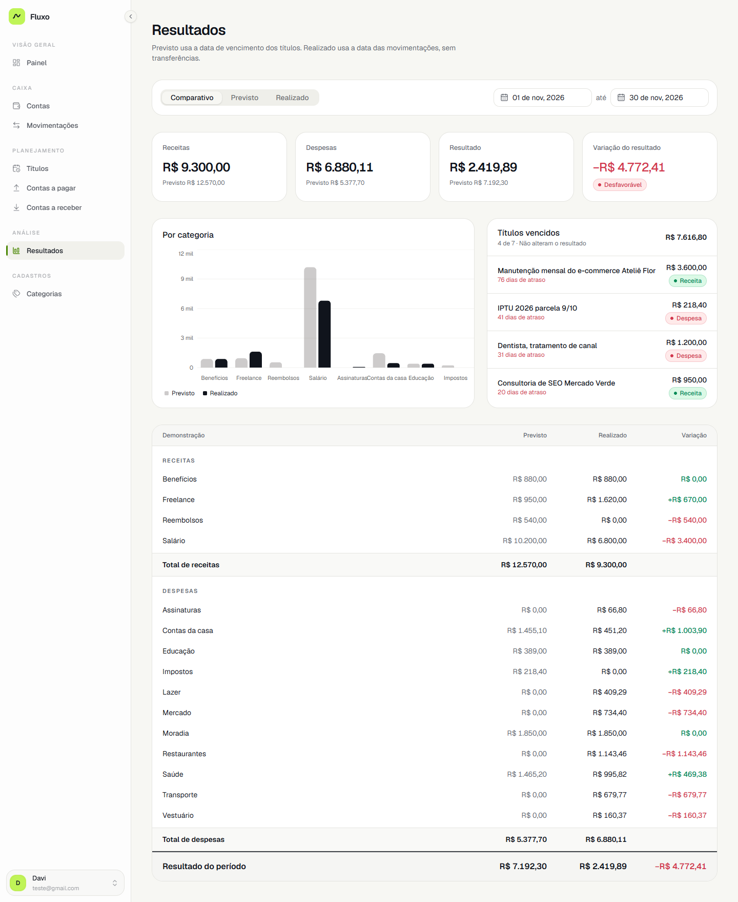

# Gerenciador de Finanças Pessoais

API REST para gestão de finanças pessoais com **DRE (Demonstração do Resultado)**, desenvolvida com Java, Spring Boot e MariaDB.

O sistema separa **previsão** de **realização**: um compromisso cadastrado (**Título**) não altera o saldo nem entra na DRE realizada até ser efetivamente liquidado por uma **Movimentação**.

Inclui uma aplicação web (`frontend/`) que consome a API e cobre todos os casos de uso. A documentação técnica completa, com backend e frontend, está em [`Documentacao_Tecnica_Projeto_Final.pdf`](Documentacao_Tecnica_Projeto_Final.pdf).

---

## Aplicação Web

Next.js 16, React 19, TypeScript, Tailwind CSS 4 e shadcn/ui. Todos os dados vêm da API (`/api/v1`), com tema claro e escuro e layout responsivo.



| Contas | Resultados (DRE) |
|---|---|
|  |  |

---

## Tecnologias

| Item | Versão / Detalhe |
|---|---|
| Java | 21 |
| Spring Boot | 4.1.1 (`webmvc`, `data-jpa`, `security`, `validation`) |
| Segurança | JWT (`jjwt` 0.12.5) + BCrypt |
| Banco de Dados | MariaDB 12.3 (Hibernate 7.4) |
| Documentação | springdoc-openapi 3.0.2 (Swagger UI) |
| Testes | JUnit 5 + MockMvc (`financas_test`) |

---

## Arquitetura

Arquitetura em camadas com fluxo unidirecional (`controller → service → repository`), `spring.jpa.open-in-view=false` e isolamento explícito entre entidades JPA e contratos HTTP via DTOs e mappers.

```text
financas/src/main/java/com/example/financas/
├── config/          SecurityConfig, SecurityFilter (JWT), TokenService, SecurityUtils, CorsConfig, OpenApiConfig
├── controller/      Endpoints REST (/api/v1/*) e validação de entrada (@Valid)
├── dto/
│   ├── request/     Contratos de entrada (records)
│   └── response/    Contratos de saída e ErroResponse padronizado
├── entity/          Entidades JPA, enums e regras de estado de domínio
├── exception/       Exceções de negócio e GlobalExceptionHandler
├── mapper/          Conversão estática Entidade <-> DTO dentro da transação
├── repository/      Interfaces Spring Data JPA e projeções agregadas da DRE
└── service/         Regras de negócio, controle transacional e locks pessimistas
```

### Conceito Central: Título × Movimentação

```text
TÍTULO (Previsão / Compromisso)  ──[pagar / receber]──>  MOVIMENTAÇÃO (Fato Realizado)  ──>  DRE & Saldo
```

| Aspecto | Título | Movimentação |
|---|---|---|
| Natureza | Compromisso futuro (`valorPrevisto`, `dataVencimento`) | Evento financeiro efetivado (`valor`, `data`) |
| Conta bancária | Não possui | Obrigatória (`conta_id`) |
| Situação | `PENDENTE`, `PAGO`, `CANCELADO` (`VENCIDO` é derivado) | Imutável após criação (correção via estorno) |
| Impacto na DRE | Compõe a **DRE Prevista** | Compõe a **DRE Realizada** e o **saldo da conta** |

---

## Modelagem do Banco (5 tabelas)

- **`usuario`**: `id_usuario`, `nome`, `email` (`UNIQUE`), `senha` (hash BCrypt), `data_cadastro`, `ativo`.
- **`conta`**: `id_conta`, `nome`, `tipo`, `saldo_inicial`, `usuario_id` (`UNIQUE(nome, usuario_id)`). Saldo atual = `saldo_inicial + receitas - despesas`.
- **`categoria`**: `id_categoria`, `nome`, `tipo` (`RECEITA`/`DESPESA`), `usuario_id` (`UNIQUE(nome, usuario_id)`). Define as linhas da DRE.
- **`titulo`**: `id_titulo`, `descricao`, `valor_previsto` (`> 0`), `data_vencimento`, `data_pagamento` (null se não quitado), `tipo`, `situacao`, `observacao`, `categoria_id`, `usuario_id`. Não armazena `conta_id` nem `valor_realizado` (calculado via `SUM(movimentacao.valor)`).
- **`movimentacao`**: `id_movimentacao`, `descricao`, `valor` (`> 0`), `tipo`, `data`, `is_transferencia`, `transferencia_par_id`, `conta_id`, `categoria_id`, `usuario_id`, `titulo_id` (opcional — `NULL` para lançamentos avulsos ou transferências).

---

## Regras de Negócio e Segurança

### Autenticação e Isolamento Multiusuário
- **Stateless JWT**: `POST /api/v1/auth/login` autentica via e-mail/senha (BCrypt) e retorna um token Bearer assinado (`TokenService`).
- **Rotas públicas**: `POST /api/v1/auth/login`, `POST /api/v1/usuarios`, `/v3/api-docs/**` e `/swagger-ui/**`. Todas as demais rotas exigem token válido de usuário ativo (`SecurityFilter`).
- **Isolamento**: `SecurityUtils` valida a posse dos recursos em todas as operações de leitura, alteração, movimentação, transferência e estorno. `GET /api/v1/usuarios` retorna apenas o próprio usuário autenticado.
- **Erros padronizados**: `GlobalExceptionHandler` e `SecurityConfig` retornam `ErroResponse` JSON para validações (`400`), autenticação (`401`), regras de negócio (`422`), conflitos (`409`), mídia não suportada (`415`) e recursos inexistentes (`404`), sem expor detalhes internos.

### Regras Financeiras Principais
- **Quitação parcial e total**: um título `PENDENTE` aceita múltiplas movimentações até `Σ movimentações ≤ valorPrevisto`; ao atingir o valor previsto, passa para `PAGO` com `dataPagamento` preenchida. Alterações e liquidações usam lock pessimista (`findByIdWithLock`).
- **Situação `VENCIDO` derivada**: nunca é gravada no banco; é calculada em leitura quando `situacao == PENDENTE` e `dataVencimento < hoje`. Títulos `CANCELADO` têm `valorEmAberto = 0`.
- **Transferência e Estorno pareado**: `POST /api/v1/movimentacoes/transferir` cria saída na conta de origem e entrada na conta de destino vinculadas por `transferenciaParId` (sem afetar a DRE). `POST /api/v1/movimentacoes/{id}/estornar` remove ambas as pernas atomicamente no caso de transferência, ou reabre o título vinculado se aplicável.
- **DRE (`GET /api/v1/dre`)**: apurada dinamicamente sem tabela própria, suportando os modos `previsto`, `realizado` e `comparativo` (padrão).

---

## Endpoints Principais (`/api/v1`)

| Recurso | Rotas |
|---|---|
| **Auth** | `POST /auth/login` |
| **Usuários** | `GET /usuarios`, `GET /usuarios/me`, `GET /usuarios/{id}`, `POST /usuarios`, `PUT /usuarios/{id}`, `DELETE /usuarios/{id}` |
| **Contas** | `GET /contas`, `GET /contas/{id}`, `GET /contas/{id}/extrato`, `POST /contas`, `PUT /contas/{id}`, `DELETE /contas/{id}` |
| **Categorias** | `GET /categorias`, `GET /categorias/{id}`, `POST /categorias`, `PUT /categorias/{id}`, `DELETE /categorias/{id}` |
| **Títulos** | `GET /titulos`, `GET /titulos/{id}`, `GET /titulos/vencidos`, `POST /titulos`, `PUT /titulos/{id}`, `POST /titulos/{id}/pagar`, `POST /titulos/{id}/receber`, `POST /titulos/{id}/cancelar`, `DELETE /titulos/{id}` |
| **Movimentações** | `GET /movimentacoes`, `GET /movimentacoes/{id}`, `POST /movimentacoes`, `POST /movimentacoes/transferir`, `POST /movimentacoes/{id}/estornar` |
| **Relatórios** | `GET /dre`, `GET /contas-a-pagar`, `GET /contas-a-receber`, `GET /resumo-financeiro` |

---

## Como Executar

1. **Banco de dados:** crie o schema no MariaDB (`CREATE DATABASE financas CHARACTER SET utf8mb4;`) e configure `financas/src/main/resources/application.properties` (em produção, defina `jwt.secret` com chave própria de no mínimo 32 bytes).
2. **Subir a API:**
   ```bash
   cd financas
   ./mvnw spring-boot:run   # Windows: .\mvnw.cmd spring-boot:run
   ```
3. **Swagger / OpenAPI:** acesse `http://localhost:8080/swagger-ui.html` (contrato em `/v3/api-docs`).
4. **Frontend:** com a API rodando, acesse `http://localhost:5173` (porta liberada no CORS):
   ```bash
   cd frontend
   npm install
   npm run dev
   ```
5. **Testes:** execute a suíte completa (usa o banco `financas_test`):
   ```bash
   cd financas
   .\mvnw.cmd test          # Linux/macOS: ./mvnw test
   ```
   A suíte conta com **86 testes** cobrindo isolamento multiusuário, segurança JWT, tratamento de erros, contrato OpenAPI e regras financeiras.
